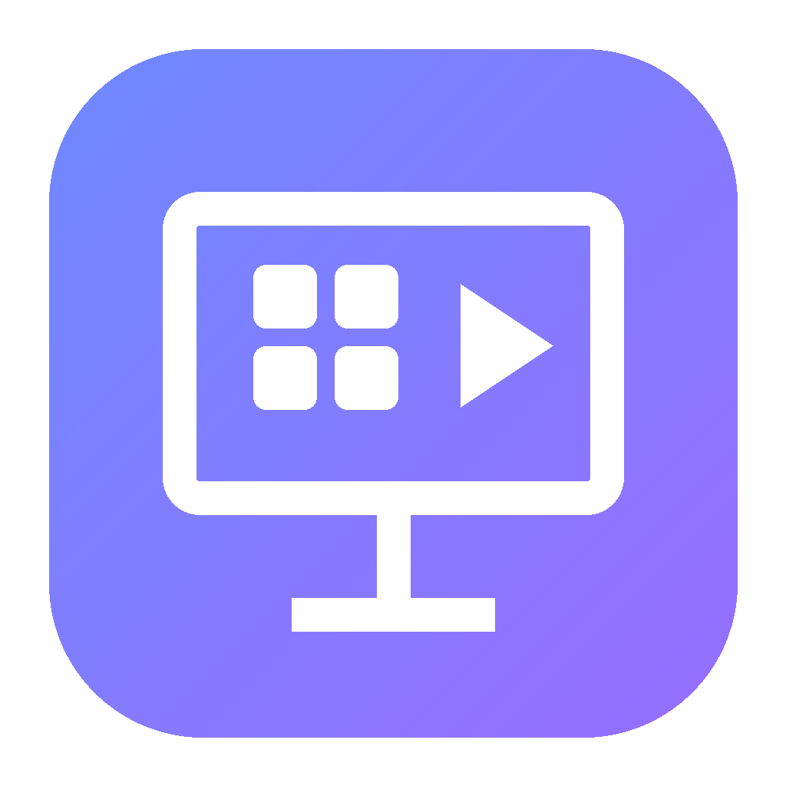

<div align="center">



# Ultimate VMs

**Plug-and-play virtual machines.** Download the app, pick an operating system from a simple menu, and it sets everything up for you.

[**Download the latest version**](https://github.com/notisaac132-star/Ultimite-VMs/releases/latest)

</div>

---

## What you can run

| | On a Windows PC | On a Mac (Apple Silicon) | On an Intel Mac | On Linux |
|---|:-:|:-:|:-:|:-:|
| **Windows 11 / 10** | ✅ | ✅ (emulated, slow) | ✅ | ✅ |
| **macOS** | ❌ ¹ | ✅ | ❌ ² | ❌ ¹ |
| **ChromeOS Flex** | ✅ | ❌ ³ | ✅ | ✅ |
| **Ubuntu, Fedora, Debian** | ✅ | ✅ | ✅ | ✅ |
| **Linux Mint** | ✅ | ❌ ³ | ✅ | ✅ |
| **Any other .iso** | ✅ | ✅ | ✅ | ✅ |

¹ Apple's license only allows macOS to run on Apple hardware, so the app doesn't offer it on PCs.
² Apple's virtualization only runs macOS guests on Apple Silicon (M1 or newer).
³ Only made for Intel/AMD chips.

## How it works

Click **New VM** (or one of the big OS tiles), pick an OS, then choose:

### ⚡ Quick Setup (one click, installs by itself)

Uses recommended settings, downloads everything, installs the OS with no questions and starts the VM.

| OS | What happens |
|---|---|
| **Windows 11 / 10** | Downloaded from Microsoft, installed hands-free: no product key, no Microsoft account, TPM/Secure Boot checks skipped. Ends on the desktop as user **User** (no password). |
| **Ubuntu, Fedora, Debian, Linux Mint** | Downloaded from the official site and installed hands-free with each distro's own automatic installer. Ends on the desktop, logged in as **user** (password **user**). |
| **macOS** | Downloaded from Apple and installed. Then finish Apple's short welcome setup (Apple doesn't allow skipping it). |
| **ChromeOS Flex** | Downloaded from Google and started. Click **Install ChromeOS Flex**, then sign in with Google (Google requires that step). |

**Pick several at once:** the first time the app opens (and from **"Want several? Pick them all at once"**), tick every OS you want and they're all set up automatically, one after another. The **Windows installer** also has a *"Which operating systems do you want?"* page; whatever you tick there is set up the first time the app opens.

### ⚙ Advanced Setup

Pick the name, processors, memory and disk size, and install from **your own file** (`.iso`; `.ipsw` for macOS; `.bin` for ChromeOS Flex), or switch to **Download it for me**.

**Test files (checking something suspicious):** in Advanced Setup, **Files to test inside the VM → Add files…** puts the files in the new VM. They appear as a **read-only drive** (a USB drive on Windows and Linux VMs, a disc on Mac-engine VMs): your original is never touched, and nothing in the VM can change the drive. Copy a file onto the VM's desktop to run it. Adding a file also ticks **Block the VM's internet and network access**, so whatever it does stays inside the VM (you can untick it). Add or remove files later in the VM's **⋯ → Settings…** (they show up the next time it starts). Up to 450 MB in total, one file at a time (zip a folder first). A VM is a strong barrier but not a perfect one: don't test real malware on a computer holding things you can't afford to lose, and keep the app and QEMU up to date.

When an OS is installed, shut it down and click **⋯ → Eject disc**. Your VMs live in a folder called **Ultimate VMs** in your home folder. Each card has **Start / Shut down / Force stop**, and the **⋯** menu has **Settings**, **Eject / Insert disc**, **Show files** and **Delete**.

Microsoft's download protection turns away plain automated requests, so for Windows the app runs **Microsoft's own download page in a hidden browser window** and takes the link from it (this is what their protection is built to accept). If that fails it tries Microsoft's free **Evaluation Center** disc (Windows Enterprise, runs 90 days without a key; the VM card shows a *90-day trial* tag), and then **shows the Microsoft page in a window** so you can click through it while the app grabs the download. Only if everything fails does the VM card show **Microsoft's site ↗** and **Choose ISO…**. What it tried is saved in `downloads.log` in the app's data folder (`%APPDATA%\Ultimate VMs`).

### First launch on Windows and Linux

The app needs [QEMU](https://www.qemu.org) (free and open source) for Windows, Linux and ChromeOS VMs. Quick Setup installs it automatically the first time; you can also click **Install VM engine** on the setup banner. It uses Windows Package Manager, or your Linux package manager. Click **Yes** if Windows asks for permission.

If a VM is slow on Windows, the app offers **Turn on fast mode**, which switches on Windows' built-in *Hypervisor Platform* feature (needs a restart).

### On a Mac

macOS and Linux VMs use Apple's built-in Virtualization framework — nothing extra to install. Windows and ChromeOS VMs on a Mac need QEMU; it's installed with Homebrew (it opens Terminal and asks for your Mac password if Homebrew isn't installed yet).

## Installing the app

- **Windows:** `Ultimate-VMs-Windows-Setup.exe` (installer) or `Ultimate-VMs-Windows-Portable.exe` (no install). If Windows says *"Windows protected your PC"*, click **More info → Run anyway**.
- **Mac:** open `Ultimate-VMs-Mac.dmg` and drag the app into Applications. If it says *"Apple could not verify…"*, go to  → System Settings → Privacy & Security and click **Open Anyway**.
- **Linux:** download `Ultimate-VMs-Linux.AppImage`, make it executable (`chmod +x`) and run it.

### Updates

The app updates itself. It checks GitHub for a new version when it opens and every few hours, downloads it in the background, and shows **Restart and update** (it also installs by itself the next time you close the app). Click the version number at the top to check right away. The portable Windows version can't replace itself, so it shows a download link instead.

## For developers

```sh
npm install
npm start              # run from source
npm run build:windows  # or build:mac / build:linux
```

| Path | What it is |
|---|---|
| `src/main.js` | Electron entry point and IPC bridge |
| `src/ui/` | The menu (VM cards, New VM wizard, settings) |
| `src/vms.js` | The VM library: create, prepare (download disc, make disk), start, stop |
| `src/catalog.js` | The OS list and where each install disc comes from |
| `src/host.js` | Decides which engine runs each OS on this computer |
| `src/engines/qemu.js` | QEMU engine (Windows, Linux, ChromeOS; Windows answer file) |
| `src/autoinstall.js` + `src/iso9660.js` | Hands-free Linux installs (answer files, booting the installer from the ISO) |
| `src/updater.js` | Auto-updater |
| `build/installer.nsh` | The Windows installer's "Which operating systems?" page |
| `src/engines/apple.js` + `mac/macvm/main.swift` | Apple Virtualization engine (macOS and Linux on Macs) |
| `.github/workflows/build.yml` | Builds all three apps on every push and publishes a release from the default branch |
